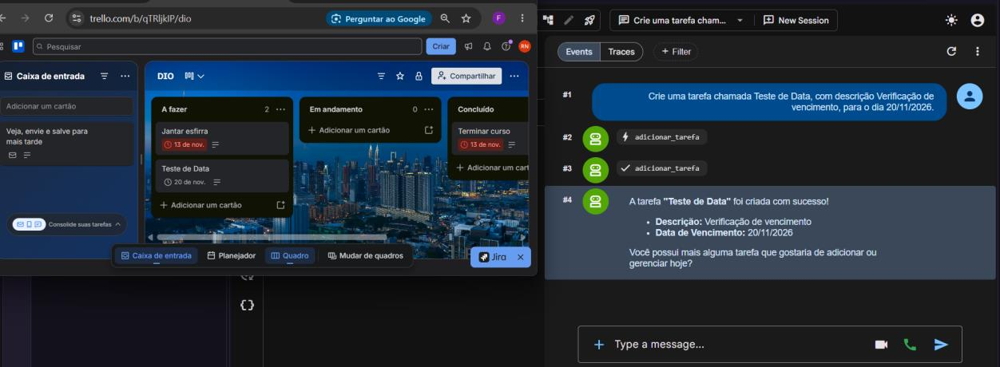
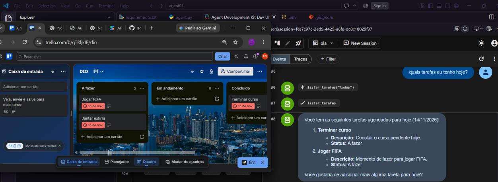
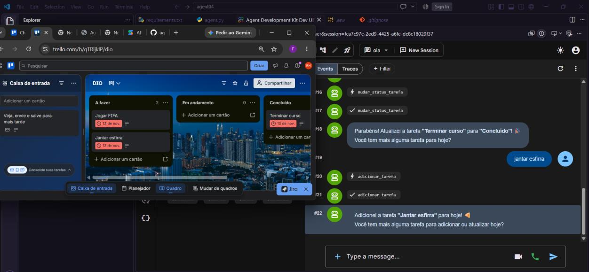
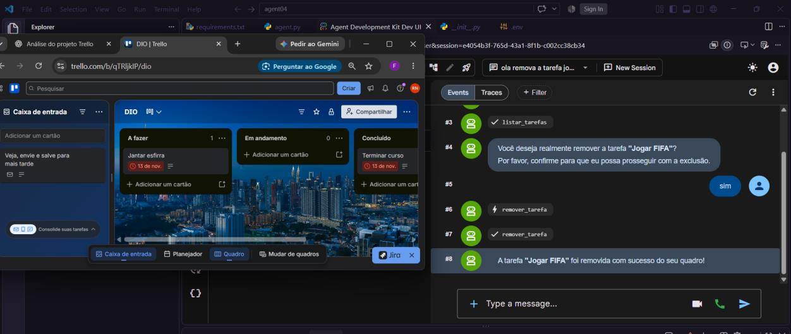
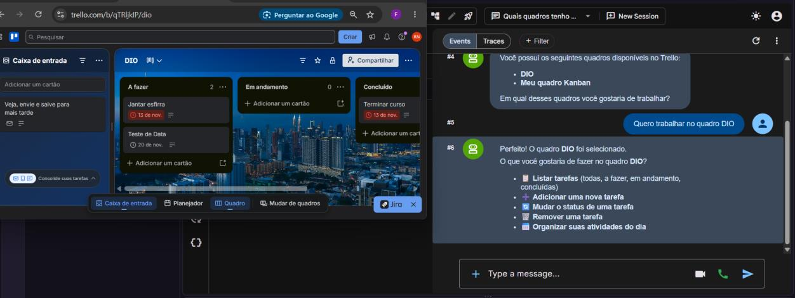
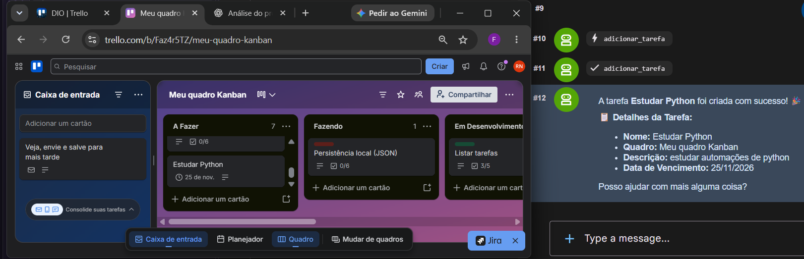

# Trello Task Manager Agent

Agente inteligente de gerenciamento de tarefas integrado ao Trello, desenvolvido em Python utilizando Google ADK e Gemini. O projeto permite organizar atividades por meio de uma conversa, utilizando inteligência artificial para criar, consultar, atualizar e remover tarefas nos quadros do Trello.

## Objetivo

O objetivo do projeto é desenvolver um agente capaz de auxiliar no gerenciamento de tarefas de forma simples e intuitiva, permitindo que o usuário interaja por linguagem natural para organizar suas atividades.

O agente utiliza o Google ADK para estruturar suas ferramentas e o Gemini para interpretar as solicitações, enquanto o Trello funciona como plataforma de armazenamento e gerenciamento das tarefas.

## Tecnologias utilizadas

- **Python** – linguagem utilizada no desenvolvimento do agente.
- **Google ADK** – framework para criação e execução de agentes de IA.
- **Google Gemini** – modelo de linguagem responsável pela interpretação das solicitações.
- **Trello API** – integração para gerenciamento dos quadros e tarefas.
- **Py-Trello** – biblioteca Python para comunicação com a API do Trello.
- **Python Dotenv** – gerenciamento das variáveis de ambiente.

## Funcionalidades

- **Listagem de quadros:** consulta os quadros disponíveis na conta Trello.
- **Múltiplos quadros:** permite selecionar e trabalhar com diferentes quadros.
- **Criação de tarefas:** cria cards com nome, descrição e data de vencimento.
- **Listagem de tarefas:** consulta todas as tarefas ou filtra por status.
- **Alteração de status:** move tarefas entre listas do quadro.
- **Remoção de tarefas:** exclui cards mediante confirmação explícita.
- **Normalização de status:** reconhece variações como concluído, concluida, done e finalizado.
- **Tratamento de datas:** interpreta datas nos formatos `YYYY-MM-DD` e `DD/MM/YYYY`, considerando o fuso horário de São Paulo.
- **Contexto temporal:** consulta a data e hora atual para auxiliar na organização das atividades.
- **Tratamento de erros:** utiliza mecanismos de captura de exceções nas operações com o Trello.

## Melhorias implementadas

Durante o desenvolvimento, foram realizadas melhorias para tornar o agente mais completo e confiável:

- Correção do tratamento de datas para evitar que o vencimento seja registrado um dia antes no Trello.
- Normalização de textos para reconhecer status com ou sem acentuação e diferenças entre maiúsculas e minúsculas.
- Implementação da ferramenta de remoção de tarefas com confirmação antes da exclusão.
- Inclusão de tratamento de erros nas ferramentas de integração com o Trello.
- Centralização da conexão com o Trello em uma única função.
- Implementação do suporte a múltiplos quadros, permitindo selecionar onde as tarefas serão gerenciadas.

## Estrutura do projeto

```text
trello-task-agent/
│
├── agenttaskmanager/
│   ├── __init__.py
│   └── agent.py
│
├── .env.example
├── .gitignore
├── README.md
└── requirements.txt
```

## Configuração e instalação

### 1. Pré-requisitos

- Python instalado.
- Conta no Google AI Studio com uma chave de API do Gemini.
- Conta no Trello.
- Credenciais de acesso à API do Trello.

### 2. Clonar o repositório

```bash
git clone https://github.com/robertomodenezineto/trello-task-agent.git
```

Entre na pasta do projeto:

```bash
cd trello-task-agent
```

### 3. Criar ambiente virtual

```bash
python -m venv .venv
```

Ative o ambiente virtual no Windows:

```bash
.venv\Scripts\activate
```

No Linux ou macOS:

```bash
source .venv/bin/activate
```

### 4. Instalar as dependências

```bash
pip install -r requirements.txt
```

### 5. Configurar as variáveis de ambiente

Crie uma cópia do arquivo `.env.example` com o nome `.env`:

```bash
copy .env.example .env
```

No Linux ou macOS:

```bash
cp .env.example .env
```

Preencha o arquivo `.env` com suas credenciais:

```env
GOOGLE_API_KEY=sua_google_api_key

TRELLO_API_KEY=sua_trello_api_key
TRELLO_API_SECRET=sua_trello_api_secret
TRELLO_TOKEN=seu_trello_token
```

**Importante:** nunca compartilhe ou publique o arquivo `.env`. Ele contém credenciais privadas utilizadas para acessar os serviços.

## Executando o agente

Com o ambiente virtual ativado e as variáveis de ambiente configuradas, execute o comando abaixo na pasta raiz do projeto:

```bash
adk web
```

A interface web do Google ADK será iniciada. Selecione o agente `agenttaskmanager` para começar a interagir.

## Exemplos de utilização

O agente permite realizar operações utilizando linguagem natural.

**Consultar quadros:**

> Quais quadros tenho disponíveis no Trello?

**Criar tarefa:**

> Crie uma tarefa chamada Estudar Python, com descrição sobre funções e orientação a objetos, para o dia 20/12/2026, no quadro Estudos.

**Listar tarefas:**

> Liste todas as tarefas pendentes do quadro Estudos.

**Alterar status:**

> Marque a tarefa Estudar Python como concluída no quadro Estudos.

**Remover tarefa:**

> Quero remover a tarefa Estudar Python do quadro Estudos.

O agente solicita confirmação antes de realizar a exclusão.

## Segurança

As credenciais de acesso são armazenadas em variáveis de ambiente por meio do arquivo `.env`, que não deve ser versionado no Git.

O arquivo `.env.example` disponibiliza apenas um modelo das variáveis necessárias para configurar o projeto.

## Demonstração do projeto

As imagens abaixo mostram o agente em funcionamento, integrado ao Google ADK Web e ao Trello.

### Criação de tarefa


### Listagem de tarefas


### Alteração de status


### Remoção de tarefa


### Seleção de quadro


### Gerenciamento de tarefas em outro quadro



## Autor

Desenvolvido como projeto prático de estudo e aplicação de conceitos de Inteligência Artificial, agentes inteligentes e integração de APIs.